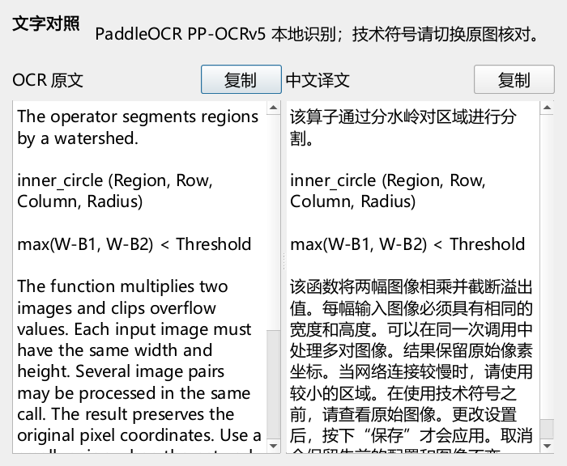
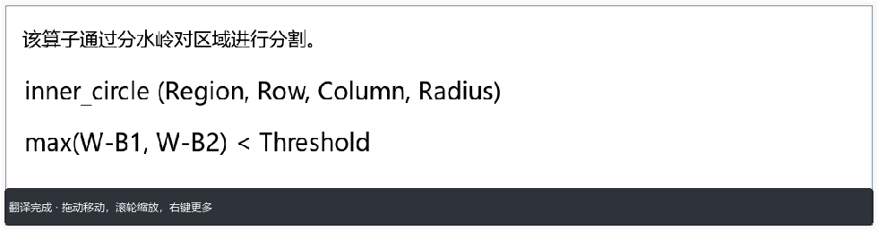
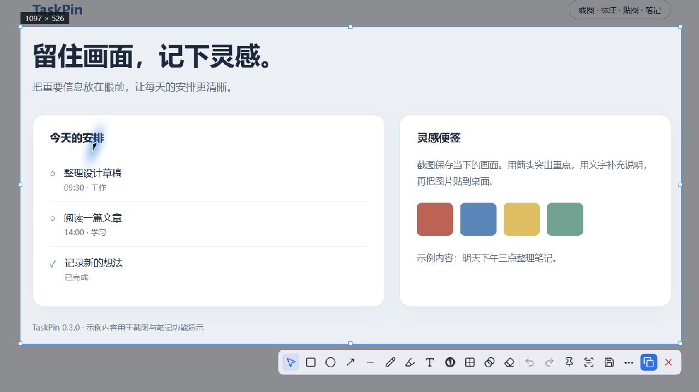
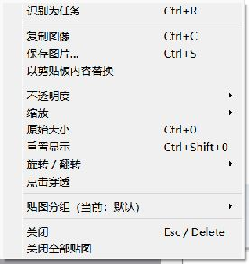
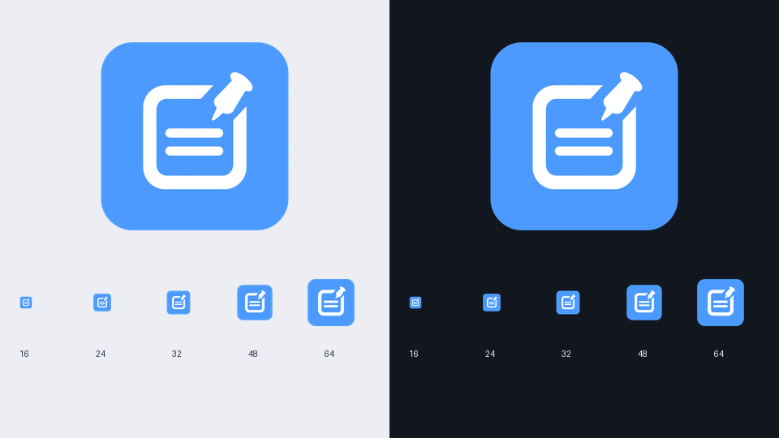

  
  <h1>TaskPin</h1>
  
<strong>Keep the picture. Capture the thought.</strong>

  
Screenshots, desktop image pins and daily tasks in one compact Windows tool.

  

    
    
    
    
    
  

  
<a href="https://github.com/YChoux-Pan/TaskPin/releases/tag/v0.4.6"><strong>Download for Windows</strong></a> · <a href="README.md">简体中文</a> · <a href="CHANGELOG.md">Changelog</a> · <a href="https://github.com/YChoux-Pan/TaskPin/issues">Report an issue</a>

---

TaskPin connects **capture → annotate or pin → recognize as a task → review on a card or calendar**. Use its screenshot tools on their own, or keep daily tasks within reach on the desktop. Screenshots, tasks and PaddleOCR are processed locally; AI is optional.

**0.4.6: OCR background warmup and live screenshot text formatting.** Local OCR and cloud translation modes warm the selected model in a low-priority background process after startup, reducing first-capture delay. Screenshot text can use a transparent background, and color/font size update the current draft immediately. A minus, current size, and plus control replace the ambiguous paired labels. The crosshair is shown only while selecting a region.

## Features

| Tool | What it does |
|---|---|
| **Screen translation** | Local OCR, source/Chinese comparison and HALCON token protection; optional DeepSeek / OpenAI-compatible text service |
| **Capture and annotate** | Region, window and current-monitor capture; arrows, text, pen, numbering, mosaic and blur; undo and redo |
| **Desktop pins** | Preserve selection position and logical size; continuous wheel zoom; opacity, rotation, flipping, click-through and groups |
| **Appearance controls** | Adjustable or disabled pin borders/shadows; live card color, width and opacity previews that revert on cancel |
| **Daily tasks** | Quick notes, Chinese time parsing, priorities, notes and carry-over; click text for details and the circle to complete |
| **Undo and calendar history** | Undo completion within 10 seconds; search and restore completed tasks; preserve historical day snapshots |
| **OCR and optional AI** | Recognize a capture as a task; show an inline pending state; retain local text if AI fails |
| **Utilities** | Capture history, whiteboard, transparent whiteboard, color picker and configurable global shortcuts |

Successful save and quick-save copy the **absolute file path** to the clipboard. Cancellation and errors leave the clipboard unchanged.

## Preview

Generated synthetic content only. Technical symbols still need comparison with the original; complex backgrounds use local covering panels.

<table>
  <tr>
    <td width="50%"></td>
    <td width="50%"></td>
  </tr>
  <tr><td align="center">Desktop pins and grouped controls</td><td align="center">One icon across desktop, tray and calendar</td></tr>
</table>

Editor and pin screenshots use demonstration data. Their version string still showed 0.2.3 before the 0.3.0 version bump; they illustrate the redesigned layout. See <a href="docs/TESTING.md">testing evidence</a> for provenance and coverage.

## Get started

**Windows 10 / 11 x64. The interface is primarily Chinese.**

1. Download <code>TaskPin-0.4.6-windows-x64.zip</code> from the [0.4.6 release](https://github.com/YChoux-Pan/TaskPin/releases/tag/v0.4.6).
2. Extract the complete folder and run <code>TaskPinQt.exe</code>. Keep all DLLs and plugin directories. No Qt SDK is required.
3. Press **F1** to capture or **F3** to pin a clipboard image. Open Settings, Calendar and other tools from the tray.

Version 0.4.6 is a preview. The release also includes source, icons, change notes, test reports and SHA256SUMS.txt. Exit through the tray before replacing application files. User data stays in the local user profile.

~~~powershell
Get-FileHash -Algorithm SHA256 -LiteralPath .\TaskPin-0.4.6-windows-x64.zip
~~~

Compare the result with the matching checksum entry.

## Shortcuts

| Global action | Default |
|---|---|
| Region capture | **F1** |
| Translate selected region | **Ctrl+T** in the F1 editor |
| Pin clipboard image / show or hide pins | **F3** / **Shift+F3** |
| Current monitor / last region | Ctrl+Alt+F / Ctrl+Alt+R |
| Quick note / toggle card / capture history | Ctrl+Alt+Space / Ctrl+Alt+D / Ctrl+Alt+G |

Editor: **Enter** copy image, **Ctrl+S** save, **Ctrl+Shift+S** quick-save, **Ctrl+P** pin, **Ctrl+R** recognize as a task, **Ctrl+Z / Ctrl+Y** undo/redo, **Esc** cancel.

The three capture/pin shortcuts follow Snipaste defaults. Upgrades retain custom bindings; the tray shows actual registered keys after conflict handling. Hover a tool for its name and shortcut.

## Data and optional AI

- **Local storage:** <code>%LOCALAPPDATA%\TaskPin\TaskPinQt\</code> contains the database, settings, capture history, log. TASKPIN_DATA selects a separate directory.
- **Restore tasks:** click text to read scrollable, selectable details and OCR text; only the circle completes a task. Use Undo or card-local Ctrl+Z immediately, or restore later from the completed list. Restoration updates today while preserving past snapshots.
- **AI is off by default:** enabling an OpenAI-compatible endpoint sends up to 4000 characters of recognized text to that address. Keys reside in local settings.json without OS credential encryption. Do not share settings, databases or logs.
- **Pending recognition:** the card displays an inline AI status and retains the local title and OCR text after errors, timeouts or restart. Requests run serially; the waiting queue is limited to three images / 128 MiB.

## Build and contribute

TaskPinQt/ is the maintained implementation: **C++17 · Qt 6.4.3 · MinGW GCC 11.2.0 · CMake · Ninja**.

~~~powershell
git clone https://github.com/YChoux-Pan/TaskPin.git
cd TaskPin
$env:QT_KIT = 'C:/Qt/6.4.3/mingw_64'
# Add matching MinGW, CMake and Ninja to PATH, or provide script parameters.
cmd /c TaskPinQt\build.cmd
powershell -NoProfile -ExecutionPolicy Bypass -File TaskPinQt/scripts/test.ps1
~~~

Current test counts, bundled PaddleOCR inference, pin geometry and release validation are recorded in the latest report. See [testing](docs/TESTING.md) for exact commits, raw reports and physical-device limits.

Read the [contributing guide](CONTRIBUTING.md) before submitting a focused improvement or reproducible issue.

## Documentation

| Project and usage | Development and verification |
|---|---|
| [Changelog](CHANGELOG.md) | [Build and package](docs/BUILDING.md) |
| [Screen translation](docs/SCREEN-TRANSLATION.md) | [0.4.3 translation pin verification](docs/reports/2026-11-21-ocr-performance-0.4.3.md) |
| [Save paths and shortcuts](docs/SAVE-PATH-HOTKEYS.md) | [Architecture](docs/ARCHITECTURE.md) |
| [Canva design provenance](docs/BRANDING.md) | [Testing and limitations](docs/TESTING.md) |
| [Issue tracker](https://github.com/YChoux-Pan/TaskPin/issues) | [Release process](docs/RELEASING.md) |

Capture covers the monitor under the cursor. Multi-monitor stitching, QR/barcode recognition and automatic clipboard-to-task creation are not implemented. Real AI services, physical printers and every mixed-DPI arrangement need separate validation.

## License and acknowledgements

TaskPin's own code is [Unlicense](LICENSE). Thanks to Qt, Lucide, Pictogrammers and MinGW; their components retain their licenses in [THIRD_PARTY_NOTICES.md](THIRD_PARTY_NOTICES.md) and [licenses/](licenses). TaskPin follows familiar Snipaste interactions and uses its own brand artwork.
