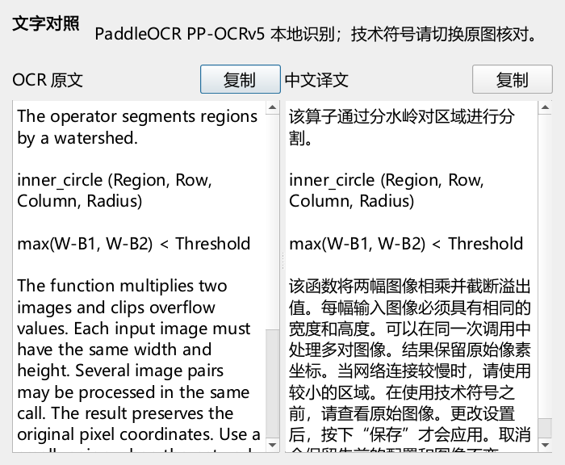
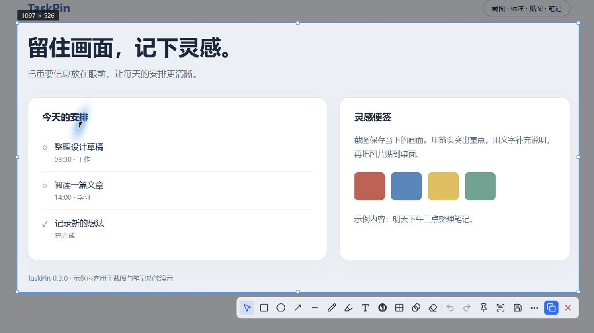
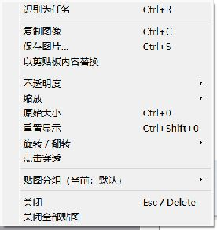
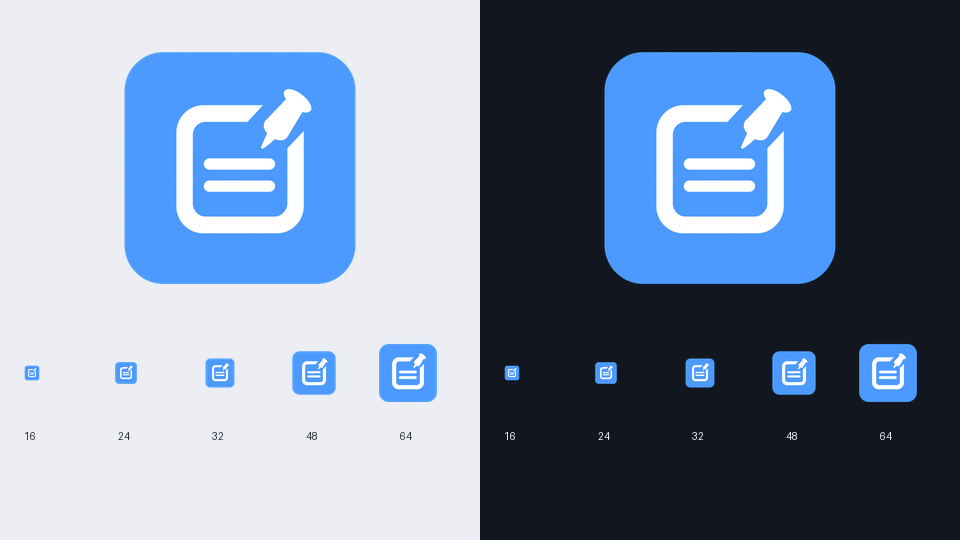

  
  <h1>TaskPin</h1>
  
<strong>留住画面，记下灵感。</strong>

  
截图、桌面贴图与每日待办，放在同一个轻巧的 Windows 工具里。

  

    
    
    
    
    
  

  
<a href="https://github.com/YChoux-Pan/TaskPin/releases/tag/v0.4.8"><strong>下载 Windows 便携版</strong></a> · <a href="README.en.md">English</a> · <a href="CHANGELOG.md">更新日志</a> · <a href="https://github.com/YChoux-Pan/TaskPin/issues">反馈问题</a>

---

TaskPin 把截图后的几个动作接在一起：**截取画面 → 标注或固定 → 识别为任务 → 在便签与日历中回看**。可以只用截图和贴图，也可以把桌面卡片作为每天的待办入口。截图、任务和 PaddleOCR 在本地处理，AI 按需开启。

**0.4.8 标注滑块。** 截图线宽、字号、序号大小和马赛克强度均可拖动调节，并即时更新当前标注。白板笔宽和贴图边框也可用滑块微调。

[功能](#功能一览) · [预览](#界面预览) · [开始使用](#开始使用) · [快捷键](#快捷键) · [开发](#构建与参与) · [文档](#文档导航)

## 功能一览

| 功能 | 可以做什么 |
|---|---|
| **截图翻译贴图** | F1 工具栏翻译，结果直接贴在桌面；拖动、缩放、透明度、原译切换和可选文字对照 |
| **截图与标注** | 区域、窗口、当前屏幕截图；箭头、文字、画笔、序号、马赛克、模糊；撤销与重做 |
| **原位桌面贴图** | 保留选区位置与显示尺寸；连续滚轮缩放；透明度、旋转、翻转、穿透与分组 |
| **可调外观** | 贴图边框、颜色和阴影可调，可全部关闭；便签颜色、宽度与透明度实时预览，取消即恢复 |
| **便签与每日任务** | 速记、中文时间解析、优先级、备注与自动顺延；点击文字看全文，点击圆圈完成 |
| **撤销与日历回看** | 完成后 10 秒内撤销；已完成列表可搜索与恢复；日历保留历史日期快照 |
| **OCR 与可选 AI** | 截图识别为任务；AI 等待时原位显示状态，完成后替换标题；失败保留本地标题和原文 |
| **顺手的小工具** | 截屏历史、白板、透明白板、取色器与可配置的全局热键 |

保存或快速保存成功后，**完整文件路径自动进入剪贴板**，方便粘贴到文件选择器或其他应用。取消、保存失败时保留原剪贴板。

## 界面预览

上图只使用程序生成的虚构文本，经过 PaddleOCR PP-OCRv5 和真实 DeepSeek 翻译，不含用户屏幕内容。复杂背景使用局部底板，技术符号仍需核对原图。

<table>
  <tr>
    <td width="50%"></td>
    <td width="50%"></td>
  </tr>
  <tr><td align="center">桌面贴图与分组操作</td><td align="center">统一的桌面、托盘与日历图标</td></tr>
</table>

编辑器和贴图截图来自专用演示内容，拍摄时版本字符串尚未从 0.2.3 更新；展示的是 0.3.0 改造布局。截图来源与验收范围见 <a href="docs/TESTING.md">测试记录</a>。

## 开始使用

**系统：Windows 10 / 11 x64。当前界面主要为中文。**

1. 在 [0.4.8 发行页](https://github.com/YChoux-Pan/TaskPin/releases/tag/v0.4.8) 下载 <code>TaskPin-0.4.8-windows-x64.zip</code>。
2. 完整解压，保留 DLL 和插件子目录，双击 <code>TaskPinQt.exe</code>。无需安装 Qt 或开发工具。
3. 按 **F1** 开始截图，按 **F3** 贴住剪贴板图片，通过托盘打开设置、日历与其他工具。

0.4.8 为预览版。[发行页](https://github.com/YChoux-Pan/TaskPin/releases)同时提供源码、图标包、改动记录、测试报告和 SHA256SUMS.txt。升级时先通过托盘退出程序，再替换程序文件。用户数据默认保存在本机用户目录。

校验下载文件

~~~powershell
Get-FileHash -Algorithm SHA256 -LiteralPath .\TaskPin-0.4.8-windows-x64.zip
~~~

将结果与发行附件 SHA256SUMS.txt 中的同名条目比较。

## 快捷键

| 全局操作 | 默认快捷键 |
|---|---|
| 区域截图 | **F1** |
| 翻译当前选区 | 框选后 **Ctrl+T** 或工具栏「翻译」；可在设置 → 热键修改 |
| 贴图 / 显隐全部贴图 | **F3** / **Shift+F3**；F1 编辑器内 F3 贴当前选区，平时贴剪贴板 |
| 当前显示器全屏 / 上次区域 | Ctrl+Alt+F / Ctrl+Alt+R |
| 速记 / 显隐任务卡片 / 截屏历史 | Ctrl+Alt+Space / Ctrl+Alt+D / Ctrl+Alt+G |

编辑器内常用：**Enter** 复制图片，**Ctrl+S** 保存，**Ctrl+Shift+S** 保存到固定目录，**Ctrl+P** 贴图，**Ctrl+R** 识别为任务，**Ctrl+Z / Ctrl+Y** 撤销与重做，**Esc** 取消。

截图、贴图与贴图显隐的默认按键与 Snipaste 对齐。升级保留自定义按键；冲突时以托盘显示的实际注册按键为准。鼠标停在工具按钮上可查看名称和快捷键。

## 数据与可选 AI

- **本地数据**：<code>%LOCALAPPDATA%\TaskPin\TaskPinQt\</code>，包含任务数据库、设置、截图历史、运行日志。TASKPIN_DATA 可指定独立目录。
- **任务恢复**：点击文字查看可滚动、可复制的全文与原文；只有左侧圆圈用于完成。完成后可点“撤销”或在卡片内按 Ctrl+Z，之后也可从已完成列表恢复。恢复更新今天的状态，保留历史快照。
- **AI 默认关闭**：主动配置并启用 OpenAI 兼容服务后，最多 4000 字符的识别文本会发送到所填服务地址。密钥目前保存在本机 settings.json，未使用系统凭据加密；配置、数据库及日志不应公开分享。
- **识别反馈**：AI 等待时显示“AI识别中…”，错误、超时或重启后保留本地标题与 OCR 原文。连续识别串行处理，等待队列最多 3 张、总计 128 MiB。

## 构建与参与

维护实现位于 TaskPinQt/，使用 **C++17 · Qt 6.4.3 · MinGW GCC 11.2.0 · CMake · Ninja**。

~~~powershell
git clone https://github.com/YChoux-Pan/TaskPin.git
cd TaskPin
$env:QT_KIT = 'C:/Qt/6.4.3/mingw_64'
# 将匹配的 MinGW、CMake、Ninja 加入 PATH，或通过脚本参数指定。
cmd /c TaskPinQt\build.cmd
powershell -NoProfile -ExecutionPolicy Bypass -File TaskPinQt/scripts/test.ps1
~~~

当前版本的测试计数、PaddleOCR 识别探针、贴图位置/缩放与发行验证见专项报告。具体提交、原始报告和设备覆盖边界见 [测试文档](docs/TESTING.md)。

欢迎提交可复现的问题或聚焦的改进，参与前请阅读 [贡献指南](CONTRIBUTING.md)。

## 文档导航

| 使用与项目 | 开发与验证 |
|---|---|
| [更新日志](CHANGELOG.md) | [构建与打包](docs/BUILDING.md) |
| [截图翻译贴图](docs/SCREEN-TRANSLATION.md) | [0.4.3 性能与快捷键实测](docs/reports/2026-11-21-ocr-performance-0.4.3.md) |
| [保存路径与快捷键](docs/SAVE-PATH-HOTKEYS.md) | [软件架构](docs/ARCHITECTURE.md) |
| [Canva 图标与设计来源](docs/BRANDING.md) | [测试记录与已知限制](docs/TESTING.md) |
| [问题反馈](https://github.com/YChoux-Pan/TaskPin/issues) | [发行流程](docs/RELEASING.md) |

当前截图范围为鼠标所在的一块显示器。跨屏拼接、二维码/条码识别和剪贴板自动建任务尚未实现；真实 AI 服务、实体打印机与全部物理混合 DPI 组合的验证进度见测试文档。

## 许可与致谢

TaskPin 自有代码采用 [Unlicense](LICENSE)。感谢 Qt、Lucide、Pictogrammers 和 MinGW 项目；第三方组件保留各自许可，完整声明见 [THIRD_PARTY_NOTICES.md](THIRD_PARTY_NOTICES.md) 与 [licenses/](licenses)。TaskPin 的操作习惯参考 Snipaste，品牌图案由本项目独立设计。
