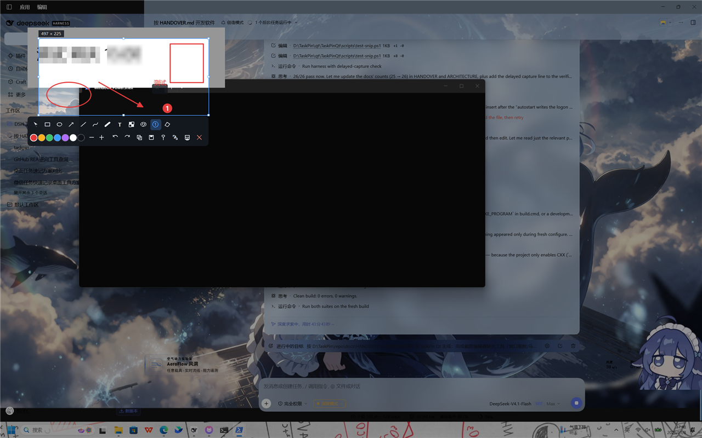

# TaskPin

一个很好用的截图工具，包含每日行程记录，资源占用小巧。

- **截图 / 贴图**（Snipaste 类）：热键截图 → 标注 → 复制 / 保存 / 贴到桌面 / OCR 变任务
- **桌面任务卡片**：右上角半透明卡片显示今天的任务，支持顺延、优先级、日历回看

C++17 / Qt 6.4.3（MinGW 11.2），Windows 10/11。**仓库只有这一条实现线**：早期 C# 版已移除，
仅保留一份历史 bundle 在仓库外的 `backup\`（见 `docs/HANDOVER.md` §0）。



## 构建

```powershell
cmd /c TaskPinQt\build.cmd     # CMake + Ninja → TaskPinQt\build\TaskPinQt.exe（自带 Qt 运行库）
```

工具链固定路径（见 `TaskPinQt\build.cmd`）：

```
Qt 6.4.3  D:\AutoEx\Qt\Qt_6.4.3\6.4.3\mingw_64
MinGW     D:\AutoEx\Qt\Qt_6.4.3\Tools\mingw1120_64
CMake     D:\AutoEx\Qt\Qt_6.4.3\Tools\CMake_64
Ninja     D:\AutoEx\Qt\Qt_6.4.3\Tools\Ninja
```

## 运行

```powershell
TaskPinQt\build\TaskPinQt.exe          # 常驻：托盘 + 右上角卡片
TaskPinQt\build\TaskPinQt.exe --snip   # 直接进截图（自动化入口，比模拟全局热键可靠）
```

命令行动词（15 个）：`--snip --full --last --pin --pins --color --board --board-transparent
--quick --toggle --recycle --history --calendar --settings --quit`，另有 `--dump [path]`、`--selftest [dir]`。

常用热键（可在设置窗口里录制）：`Ctrl+Alt+A` 截图 · `Ctrl+Alt+F` 全屏 · `Ctrl+Alt+R` 上次区域 ·
`Ctrl+Alt+V` 贴住剪贴板 · `Ctrl+Alt+H` 显示/隐藏贴图 · `Ctrl+Alt+Space` 速记 · `Ctrl+Alt+D` 卡片 · `Ctrl+Alt+G` 历史。

## 测试

```powershell
# 单元/集成自检：53 项断言，退出码 0 = 全过
Start-Process -Wait -PassThru TaskPinQt\build\TaskPinQt.exe `
  -ArgumentList '--selftest', "D:\TaskPin\repo\docs\artifacts\selftest"

# 真机交互回归：26 项断言，模拟鼠标键盘并截图（写 docs\artifacts\，已 gitignore）
powershell -NoProfile -ExecutionPolicy Bypass -File TaskPinQt\scripts\test-snip.ps1
```

运行期数据：

```
%LOCALAPPDATA%\TaskPin\TaskPinQt\
├─ taskpin.db        任务库（WAL）
├─ settings.json     配置
├─ taskpinqt.log     运行日志
├─ history\snip\     截屏历史
└─ ocr\              OCR 临时图与结果
```

## 目录

```
TaskPinQt\build.cmd         一键构建
TaskPinQt\CMakeLists.txt    构建定义（Qt6 Core/Gui/Widgets/Sql/Network/PrintSupport）
TaskPinQt\src\app           AppHost：托盘 / 热键 / 命令通道 / 窗口与 OCR/AI 编排
TaskPinQt\src\core          Store / Settings / TimeParser / FileNaming / History / Ocr / AiClient / SelfTest
TaskPinQt\src\platform      Hotkeys / HotkeyText / HotkeyEdit / ScreenCapture / WindowPicker / WindowFx / Autostart
TaskPinQt\src\ui            SnipOverlay / Annotation / CardWindow / PinWindow / HistoryDialog /
                            CalendarWindow / SettingsDialog / ColorPickerOverlay / WhiteboardWindow / QuickAddDialog
TaskPinQt\scripts           test-snip.ps1（回归）· show-image.ps1（测试用固定窗口）· fixtures\
docs\HANDOVER.md            需求与进度的唯一事实源（新人先读这个）
docs\ARCHITECTURE.md        分层、数据模型、流程时序
docs\screenshots\           验收截图（commit 的存证）
docs\reports\               selftest / 交互回归报告
docs\legacy\                C# 版历史文档（只读参考）
```

依赖方向 `ui → core → platform`，`app` 可用全部；`<windows.h>` 只允许出现在 `src\platform\`。

## 已知缺口

- 二维码 / 条码（R2）：离线需要 zxing-cpp，当前工具链无法本地编译，暂未实现。
- 剪切板监听自动建任务：C# 版有，Qt 版未做。
- 其它技术债见 `docs/HANDOVER.md` §9。

## 许可

[Unlicense](LICENSE)（public domain）。
