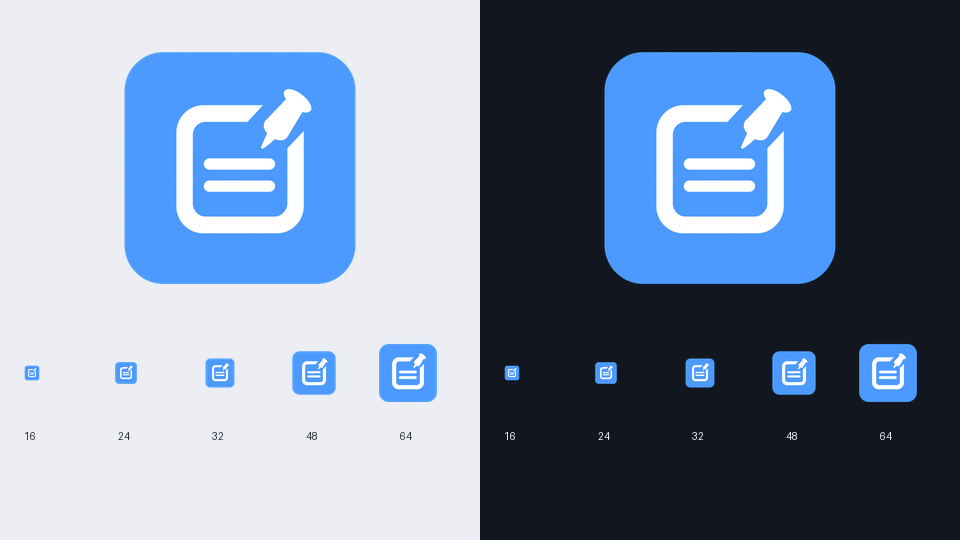

# Canva brand icon verification — 2026-11-20

The user completed Canva sign-in and requested a TaskPin icon matching the existing software. The Canva plugin's connector tools were unavailable in this conversation, so the actual design was created through Canva's website. Two generations produced the capture frame, pushpin and two note lines; the second removed the unwanted long shadows. The result was saved to Canva Uploads and opened as a named design, its blue was adjusted in Canva, and its final PNG was downloaded. The design page reported all changes saved and download completed. [Source and preparation details](../BRANDING.md).

The production image retains the Canva geometry, removes only the connected exterior white background, normalizes the two-color artwork, and supplies a transparent master plus nine PNG/ICO sizes. Visual inspection covered 16, 24, 32, 48 and 64 pixels on both light and dark backgrounds; this is an asset preview, not proof of every physical Windows DPI setting.

Qt resources provide one shared icon for the application, tray and windows; a Windows ICON resource supplies Explorer and the desktop shortcut. The calendar paints the icon in its header before the month title and sets its native window icon. The RC source explicitly depends on the ICO, so incremental icon regeneration rebuilds the embedded icon as well as Qt PNG resources.

## Verification

- Qt 6.4.3, MinGW GCC 11.2.0, C++17, Windows Release build succeeded after final code changes.
- Fresh screenshot QtTest 43/0, integration QtTest 35/0, experience QtTest 20/0, CTest 3/3, selftest 53/0; zero failures or skipped cases. Original reports: [canva-icon-tests-20261120](canva-icon-tests-20261120).
- Read-only independent review found no Critical or Important defects. Its minor incremental RC dependency finding was fixed and the generated Ninja dependency checked, followed by a fresh build and test run.
- Local installation updated to EXE SHA-256 `43ea29c2bb0be3e1410782b164b970c2412b3e0aecd397ebb9bdaac2212bf558`. A private backup was created before replacing the executable. Task records, daily snapshots, history files and all existing settings were compared and preserved. Private backup contents are not in this repository.
- Desktop shortcut targets `D:\TaskPin\app\TaskPinQt.exe`; the installed executable contains the new icon. Windows may retain a previous rendered shortcut thumbnail until Explorer refreshes its icon cache.

An isolated native test instance was launched and a card window was observed, but a stable calendar screenshot was not obtained. The asset preview, resource/build verification and existing QtTest calendar checks are the evidence for this icon update; do not treat the session as a completed continuous mouse acceptance run. Other previously documented physical-device and real-AI limits remain in [TESTING.md](../TESTING.md).

This change updates visual assets and their loading; task storage, notes and completion behavior are unchanged.
