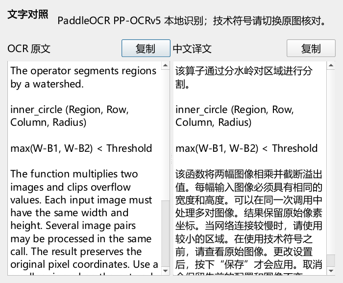

# TaskPin 0.4.3 · OCR 耗时、缩放与快捷键验收

发布时间：2026-11-23。性能采样：2026-11-21；最终回归：2026-11-23。基线为 0.4.2 / `8b4446b`，本报告随 0.4.3 源码发行。

## OCR 与翻译谁更慢

在同一台 Windows 11 x64 电脑、同一默认 PP-OCRv5 mobile 模型、相同程序生成图片上，依次运行旧版单次进程与新版复用进程。每组 3 次；真实 DeepSeek、关闭翻译缓存，分别用单调时钟记录 OCR、翻译客户端、绘制和总时间。采样时没有同时编译。

| 图片 | 旧版 OCR 中位数 | 新版 OCR 中位数 | 旧 / 新翻译中位数 | 旧 / 新总流程中位数 |
|---|---:|---:|---:|---:|
| 小图，约 107 字符 | 2.253 秒 | 1.094 秒 | 1.011 / 1.278 秒 | 3.256 / 2.269 秒 |
| 段落，约 537 字符 | 2.407 秒 | 1.269 秒 | 1.144 / 1.232 秒 | 3.530 / 2.627 秒 |

旧版耗时主要在 OCR；新版连续识别减少了每次启动 Python、导入依赖和加载模型的开销。小图连续两次复用的 OCR 中位数为 **1.041 秒**。新版首次识别仍为 **2.184 秒**；空闲释放后首次需要重新加载。样本中的模型加载复用阶段为 0 毫秒，绘制通常为 0–11 毫秒。

这是单机、有限样本的观测，不能作为所有图片、机器或网络的延迟保证。网络排队、文本长度、模型响应和重试仍会改变翻译时间。上表每列独立取中位数，因此相加不必等于总流程中位数。旧版第一次 OCR 为 4.405 秒，也保留在原始数据中，没有丢弃慢样本。

原始样本与汇总见 [证据目录](2026-11-23-ocr-performance/)。先前与编译同时进行的 6 次探索样本只用于定位瓶颈，不混入上表。

## 模型可调整与复用

在「设置 → 截图翻译 → 本地 OCR」选择默认 PP-OCRv5 mobile 或自定义本地 JSON。便签 OCR 与翻译共用选择。配置允许兼容的 PP-OCRv4/v5 mobile/server ONNX、检测/识别路径及 SHA256、CPU 线程参数。实际自定义 PP-OCRv4 mobile 已经过生成中英文图片与原生翻译探针，元数据确认使用 PP-OCRv4，而非修改显示标签。

完整配置格式见 [OCR README](../../TaskPinQt/ocr/README.md#local-model-profiles)。任意 ONNX 或未来家族不保证兼容；新家族需适配引擎，识别模型需具备匹配字符字典。模型哈希、缺失、未知家族及不兼容文件都会明确失败，不自动下载或静默回退。

一个应用级进程缓存一组模型，至多 8 个待处理请求，90 秒活动超时，空闲 60 秒退出。取消活动请求会重启进程，排队取消不打断其他所有者；窗口关闭和迟到回调有请求 ID 隔离。截图、识别文字不落盘，进程只保留模型状态。

保存自定义模型先在可取消的后台进程核对哈希并实际加载 ONNX。验证期间不写配置，修改草稿或取消使旧验证失效；验证成功后才提交，配置写入失败会回滚。不会在 GUI 线程重复读取大型权重计算哈希。

## 缩放、对照与快捷键

- 反向滚轮从当前显示倍率计算，保留光标下的图像点；避免先继续放大再缩小。平滑绘制和透明留白清理共用同一图像；125% / 150% 显示缩放的缓存采样相位另有像素回归。
- 对照窗独立不透明，使用紧凑标题/状态、等宽可调整双栏、各栏顶部复制按钮；初始尺寸受可用屏幕限制，文字区域占窗口高度超过 60%。
- F1 框选后 F3 固定当前选区与标注；空选区不会改贴剪贴板。普通桌面状态下 F3 仍贴剪贴板。工具栏跟随实际备用键。
- 「设置 → 热键」新增截图内翻译，默认 Ctrl+T，仅在编辑器生效。测试覆盖自定义键、重载、取消、文字编辑焦点，以及全局备用键/编辑器内置操作冲突。Ctrl+P 保留为贴图兼容按键。

## 自动验收方式

采用 **Playwright Test + GitHub Actions**。TaskPin 是 Qt Widgets 原生程序，Playwright 的浏览器驱动不能直接访问 QWidget。本项目由 Playwright 测试调度器启动真实原生夹具和 OCR 引擎，检查窗口几何、像素、信号、JSON 与截图。没有网页替身，也没有桌面鼠标移动、系统点击或按键注入。Qt 内部事件验证实际处理逻辑。

完整入口、依赖锁及报告位置见 [自动验收](../AUTOMATED-ACCEPTANCE.md)。Windows CI 和标签发行保留全部 QtTest、真实模型行为测试、自检及 Playwright 门禁；付费 AI 不在 CI 中调用。云端翻译的性能样本只使用生成文本，Key 仅在内存中读取，报告不含密钥。

专项回归包括：模型冷/热加载、切换、错误、队列/取消/关闭/重入、异步验证草稿与回滚；滚轮反向、光标锚点、负原点、多 DPR 和缓存稳定性；对照窗透明度/比例；截图导出、设置持久化和快捷键路由。原始 Qt/JUnit、Playwright 和实际发行字节核验随验证包提供。

本地最终 Release：CTest 5/5；截图 59、集成 48、体验 30、翻译/模型 57、画布 18，合计 **212 passed / 0 failed / 0 skipped**；另有 **53/0** 自检。100% / 125% / 150% / 200% 显示缩放分别通过 10 项像素/几何专项断言，分数显示缩放的缓存问题已先失败再修复。Playwright 持续执行同样的分数缩放检查，防止仅测试原图 DPR 而漏掉窗口实际 DPR。

最终 Playwright **10/10**，本机一次执行约 25 秒；报告 HTML、JSON、JUnit 和原生 PNG 均已生成。报告路径按仓库根目录解析，与 GitHub Actions 上传目录一致。所有测试均使用独立数据目录，未模拟桌面鼠标操作。

这些结果验证应用逻辑和离屏渲染，不代表已验证所有 Windows 合成器、显卡、实体显示器、第三方软件抢键或全新 Windows 10 环境。物理打印机仍未验收。技术符号需要对照原图。最终源码以 `v0.4.3` 为准，正式包需完整保留 `ocr/` 运行时。
