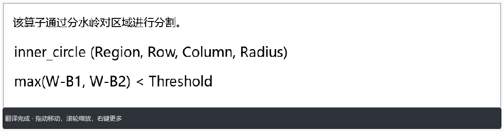

# TaskPin 0.4.2 · 区域截图翻译贴图与 PaddleOCR 验证

日期：2026-11-21。基线：0.4.1 / `713dd9e`。本报告随 0.4.2 源码发布；发行提交以 `v0.4.2` 标签和发行页为准。

## 最终行为

按 **F1** 框选，在现有工具栏选择 **翻译 / Ctrl+T**。它使用当前选区与标注，直接生成桌面贴图。可拖动、滚轮缩放、透明度、旋转、翻转、穿透及分组；异步完成和原译切换保留位置、缩放、方向与隐藏状态。文字对照仅在右键主动打开。旧独立托盘按钮、Ctrl+Alt+T 和专用选区遮罩已经移除。

便签识别与翻译共用 PaddleOCR；翻译共用原 AI 设置的地址、模型和 Key。翻译不自动新增任务、不写截图历史，也不修改上次截图区域。新安装默认本地 OCR，云端模式需授权文字发送；没有离线翻译模型。

## 实际模型与部署

| 组件 | 本次固定版本 |
|---|---|
| 检测 / 识别 | PaddleOCR PP-OCRv5 mobile Det / Rec，20.5 MiB |
| 执行封装 | RapidOCR 3.10.0，显式选择 PP-OCRv5；禁用角度分类器 |
| 推理 / Python | ONNX Runtime 1.32.0 CPU / CPython 3.12.10 embeddable |
| 完整 OCR 运行时 | 262.3 MiB；21 个 wheel，含 app-local MSVC DLL 和许可证 |

实际 ONNX 模型来自 RapidOCR 对 PaddleOCR 模型的转换。没有调用 Windows.Media.Ocr。模型、下载 URL、依赖及 SHA-256 见 [runtime-lock.json](../../TaskPinQt/ocr/runtime-lock.json)，许可证见 [运行时声明](../../licenses/PADDLEOCR_RUNTIME_NOTICE.md)。模型推理不联网、不自动下载；PNG 经 stdin，文字/坐标/实际识别分数经 stdout，识别内容不落盘。

检测器可能把一句话拆成多个位置略有抖动的框。本轮已用真实坐标复现词序错乱，再补测试修复：先归并同一行的相邻文字，保留列间距；便签与翻译共享这一逻辑。合并行的置信度取构成片段中的最低实际分数，不解释为准确率。

## 自动回归

Windows 11 x64；Qt 6.4.3 / MinGW 11.2.0 / Release。独立 TASKPIN_DATA、offscreen、自动化模式；没有操作用户屏幕或任务。

| 套件 | 通过 | 失败 / 跳过 |
|---|---:|---:|
| 截图编辑器 | 52 | 0 / 0 |
| 集成与数据隔离 | 35 | 0 / 0 |
| 便签体验 | 20 | 0 / 0 |
| 翻译、设置与贴图生命周期 | 46 | 0 / 0 |
| 译图渲染 | 18 | 0 / 0 |
| 应用自检 | 53 | 0 / 0 |

CTest 为 **5/5**，QtTest 合计 **171/0**，另有 **53/0** 自检。原始文字/JUnit、OCR 行为报告及合成探针见 [本轮证据目录](2026-11-21-translation-pin-paddle/)。

覆盖按钮和 Ctrl+T、100/125/150/200% DPR、负屏幕原点、标注保留、剪贴板/任务/历史无副作用、移动缩放隐藏期间完成、多贴图所有权、打开菜单时关闭、取消 OCR 后重试、过期回调、共享设置和网络错误。DPI 是夹具，不能代替所有实体多屏验收。

`test.ps1` 另运行真实 PP-OCRv5 行为测试：生成英文、中文、深色技术文字；检查实际文本、坐标与置信度，验证 16MP 空白、4 类非法输入、模型篡改与模型缺失均正确处理。子进程 PATH 只含 System32，验证不依赖系统 Python 和开发环境；构建器另做完整离线模型自检。测试没有跳过。

## 完整翻译链路

`translation_probe.cpp` 生成 1100×280 的虚构英文/代码/公式图片，通过真实 SnipOverlay 的 Ctrl+T 信号进入翻译贴图。实际 PP-OCRv5 → 现有 DeepSeek 文字接口 → 原图覆盖，最终状态 PRESENTING；无默认对照弹窗，移动与缩放断言通过。本次本机单次约 3.9 秒，不能作为其他设备或网络的性能保证。密钥只在内存中读取，报告和源码不含密钥。

模型把 `inner_circle` 读成 `inner circle`，并遗漏公式的 `<`。代码行保留原图；翻译服务回显原文时也保留原像素，因此预览中的下划线与比较符仍在。文字对照保留真实 OCR，不伪造完美识别。技术符号仍需核对原图。

## 验证边界与发行复核

本轮生成图片与窗口渲染为隔离自动化探针，不声称完成物理鼠标、剪贴板占用、Windows 10 全新机器、实体打印机或所有物理混合 DPI 显示器验收。云端只实测当前 DeepSeek 配置和虚构内容。OCR 首次启动约数秒，每次重新加载模型，识别质量受字体、分辨率和背景影响。

GitHub 分支 CI、标签发行、实际下载字节校验、中文路径便携包及本机升级结果随发行附加验证包记录。不得把构建目录直接当成已发布附件；发行包必须完整保留 `ocr/`。本机升级应保留任务、每日状态、历史、AI Key 与偏好，允许移除旧独立翻译快捷键。
